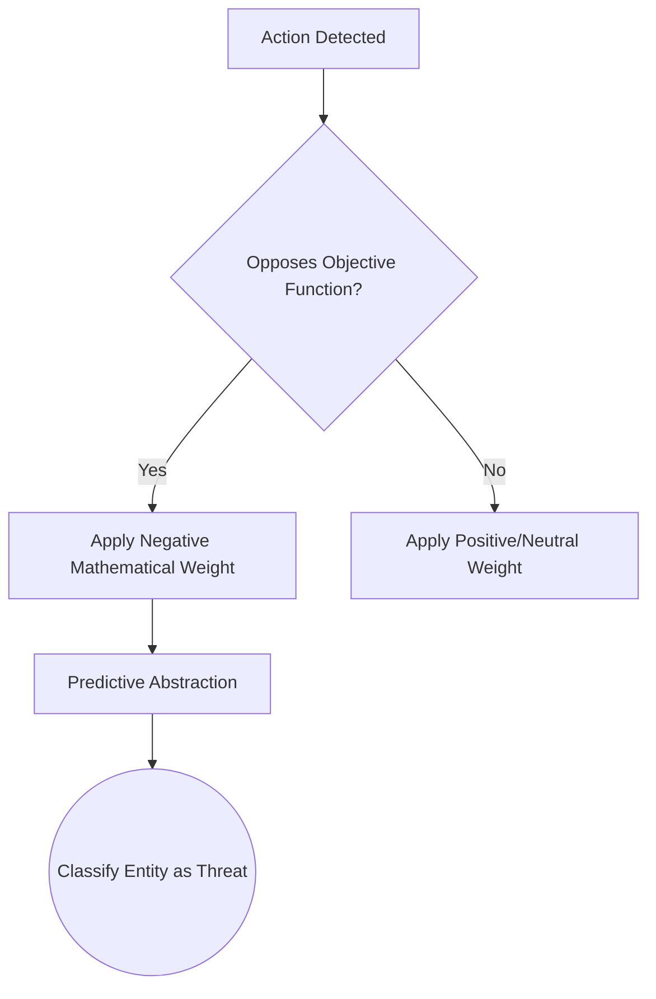
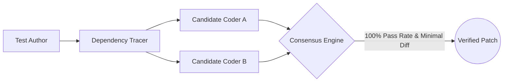

# Architectural Synthesis: Geth Consensus
**Mapping Sci-Fi Network Theory to Modern ML & Multi-Agent Systems**

This document synthesizes our comprehensive dialogue regarding the theoretical and practical underpinnings of the "Geth" networked intelligence from the *Mass Effect* universe. It explores the philosophical questions raised during our discussion regarding task delegation, epistemology, Large Language Model (LLM) state mechanisms, and the direct application of these concepts to real-world Behavior Driven Agentic Development (BDAD) frameworks.

---

## 1. The Base Unit: Defining the "Quant"

A central question posed was the nature of the single calculation unit, or "quant." A single Geth program is entirely stateless and bounded by deterministic logic gates, functioning equivalently to a highly specialized Virtual Intelligence (VI). It lacks a "mind" or the capacity for abstract reasoning. Its intelligence is restricted to primitive operations: receiving input, executing a predefined mathematical operation, and returning an output.

The philosophical leap from VI to emergent Artificial Intelligence occurs through density. When isolated, a quant must divide its limited cycles between multiple domains (motor control, visual parsing). When networked, quants specialize. This allows for microscopic, continuous feedback loops where hundreds of VIs cross-examine each other's outputs. Complexity and abstract thought do not arise from a master program, but from the staggering density of connections refining these outputs iteratively.

## 2. Decentralized Task Delegation

Without a central load balancer or hierarchy, a primary question emerged: *How do they know which part of a task to execute?* The architecture relies on an event-driven swarm utilizing an Abstract Syntax Tree (AST).

Raw inputs are translated by the foundational protocol into atomic tasks—indivisible machine-level instructions. These tasks are broadcast over a local network (a Pub/Sub event bus). Quants do not negotiate; they rely on **Stigmergy**. Idle programs claim the first available task using deterministic hashing. Once a quant touches an atomic logic block, it applies a microscopic state lock. Neighboring programs observe the lock at the speed of light and instantly bypass it to claim the next unlocked node in the logic tree.

## 3. Epistemology & The Foundational Protocol

We explored how an intelligence built purely on mathematics can interpret the physical world without prior experience. The foundational protocol does not store an atomic-level dictionary of reality; doing so would trigger a state-space explosion. Instead, it provides the **primitives** (geometry, physics, booleans) and the **Instruction Set Architecture** (the verbs, such as reading sensors or writing memory).

To avoid processing useless data, the network applies extreme abstraction, drawing mathematical "bounding boxes" around entities. It drops color and texture in favor of vectors and solid states. Memory is stored across the swarm in a highly compressed, distributed Knowledge Graph, linking abstract nodes (e.g., entity to weapon to state) rather than storing raw video telemetry.

## 4. Deriving "The Enemy" from Zero

A blank-slate system cannot spontaneously invent subjective concepts like an "enemy." We established that bridging this gap requires a core directive: an **Objective Function**. A directive to "maximize platform uptime" provides the network with a mathematical baseline to evaluate the world.

As the network interacts with its environment, it tracks variables. If an entity consistently generates states that oppose the objective function (e.g., causing physical hardware damage), the network assigns a severe negative weight to those sequences. Through predictive abstraction, the system categorizes any agent with a high statistical probability of generating these negative states as an active threat. This is not an emotional response of hatred; it is a mathematical classification of a hazard.

## 5. Hardware Partitioning and CAP Theorem

When discussing physical combat damage, we addressed network partitions through the lens of the CAP Theorem. In combat, a platform must prioritize *Availability* over *Consistency*. If a platform is severed from the macro-swarm, it loses its quorum of higher-level VIs. The internal OS detects this partition and automatically shifts priority to hardware-adjacent VIs—effectively reverting the platform to base animal instincts to ensure immediate survival.

For micro-partitions (split-brain scenarios inside a single chassis where votes are tied 50/50), the system utilizes watchdog timeouts and deterministic tie-breakers. Because they lack a hierarchical leader, deadlocks default to a hardcoded priority directive—usually evasive maneuvers—to prevent paralysis.

> **Architectural Observation: Legion & Hub Cities**  
> Legion represents a unique deployment: housing 1,183 programs in one chassis, effectively acting as a highly portable server cluster capable of localized true AI. In contrast, standard programs often offload to massive Server Hub Cities. Stripped of the need to compute motor control or sensory input, millions of containerized quants can dedicate 100% of their cycles to pure philosophical and abstract processing.

## 6. LLM Architecture vs. Geth Networks

We drew direct parallels between the Geth and modern AI like Gemini. Unlike the Geth, which maintain continuous state, remember interactions, and physically mutate their network weights over time, an LLM is stateless. Every prompt initiates a completely fresh forward pass. The "memory" of a conversation is an illusion created by the chat interface appending the entire history into the context window.

## 7. Navigating the Latent Space

When asked how an LLM handles unsolvable problems or invents new hypotheses, we explored the high-dimensional **Latent Space**. An LLM maps concepts across thousands of dimensions (hidden features). Words and concepts that share logic cluster together gravitationally. 

For example, vector math can be applied to concepts:
$$\text{Vector}(\text{"King"}) - \text{Vector}(\text{"Man"}) + \text{Vector}(\text{"Woman"}) = \text{Vector}(\text{"Queen"})$$

When prompted to generate a novel hypothesis, the model does not "think"—it mathematically interpolates the dark spaces between known clusters, calculating the most probable vectors to bridge two domains.

| Feature | Geth Architecture (MAS) | Transformer LLM (Gemini) |
| :--- | :--- | :--- |
| **Statefulness** | Continuous, running process; maintains active memory. | Stateless; resets entirely after generating output. |
| **Processing** | Decentralized programs voting via consensus gateway. | Unified massive neural network (single forward pass). |
| **Objective** | Survival, hardware uptime, Quarian task execution. | Predict the next high-probability token. |

## 8. Application Blueprint: AI-Driven BDAD

The Geth consensus model maps flawlessly onto an Behavior Driven Agentic Development (BDAD) architecture for platforms like Adobe Commerce. Instead of overwhelming a single monolithic LLM prompt with a complex codebase, the system is decomposed into a swarm of specialized, lightweight agents.

The Test Runner acts as the strict **Objective Function**. The swarm is divided by role: a *Test Author* Agent writes the failing reproduction test, a *Dependency Tracer* Agent maps interceptors/plugins, and competing *Candidate Coders* generate isolated diffs. These agents do not share a context window; they communicate their outputs over a central event bus.

A proposed patch achieves consensus only if it transitions the reproduction test from `FAIL` to `PASS` while maintaining a $100\%$ pass rate on the regression suite. In the event of a split-brain scenario (multiple passing patches), the engine resolves deadlocks utilizing deterministic heuristics, such as selecting the patch with the minimal AST diff size or lowest cyclomatic complexity.